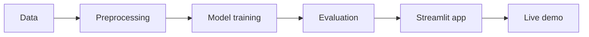

[Email](mailto:sripathisrinidhiuk@gmail.com) · [LinkedIn](https://www.linkedin.com/in/srinidhi-sripathi-269980285/)

[Portfolio](https://sripathisrinidhi.github.io) · [Email](mailto:sripathisrinidhiuk@gmail.com) · [LinkedIn](https://www.linkedin.com/in/srinidhi-sripathi-269980285/)

## Model Card

```yaml
name: Sripathi Srinidhi
training: MSc Data Science, University of Greenwich
focus: [machine learning, computer vision, data science]
strength: taking models from notebook to deployed app
intended_use: ML/AI and data science internships
status: open_to_work
```

## Deployed Models

| Project | Task | Approach | Evaluation | Links |
|---|---|---|---|---|
| **Fruit and Vegetable Classifier** | Image classification across 36 classes | CNN with TensorFlow/Keras | About 95.7% validation accuracy | [Demo](https://image-classifier-app-ez255hscilvdswgkgzwarz.streamlit.app/) · [Code](https://github.com/sripathisrinidhi/image-classifier-app) |
| **Smart Plant Health Classifier** | Three-class plant health prediction | Random Forest with scikit-learn | Proof of concept on simulated data | [Demo](https://smart-plant-watering-alert-systemgit-btrrzagvokqp8nacgfycwn.streamlit.app/) · [Code](https://github.com/sripathisrinidhi/Smart-Plant-Watering-Alert-System) |

## Pipeline



## Stack


## Contact

[Email](mailto:sripathisrinidhiuk@gmail.com) · [LinkedIn](https://www.linkedin.com/in/srinidhi-sripathi-269980285/)
